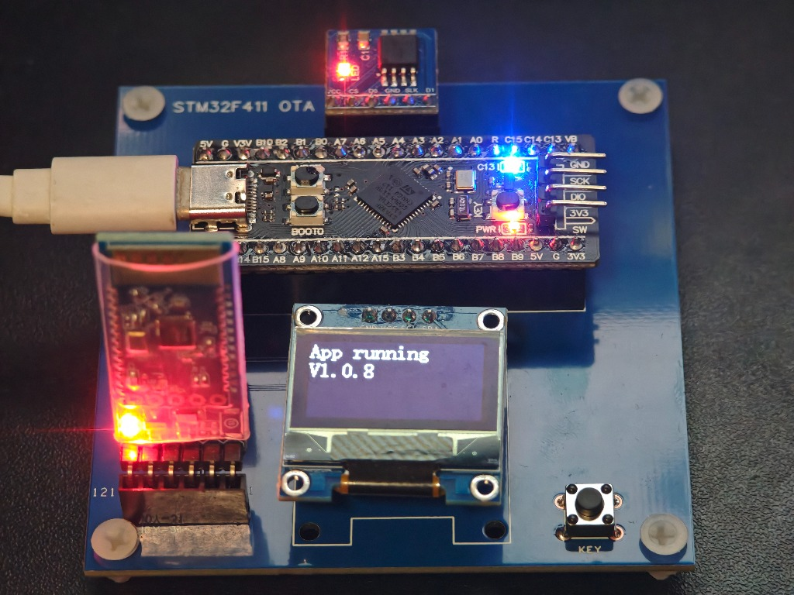
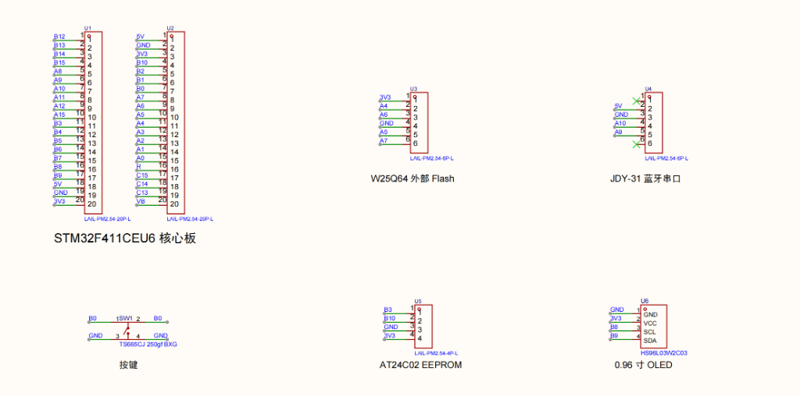

# STM32F411 双区备份蓝牙/云端 OTA 系统

基于 `STM32F411CEU6` 实现支持**断电恢复与试运行失败自动回滚**的固件升级系统。上位机（Windows 桌面端 / Android 手机端）从云端服务拉取新固件或读取本地 `.bin`，经 `JDY-31` 蓝牙串口分包写入外部 `W25Q64` Flash，由 Bootloader 完成备份、搬运、试运行看门狗监管与确认转正，并通过 `SSD1306` OLED 实时显示状态。

仓库同时保留早期在 `STM32F103C8T6` 上完成验证的基础版工程（[`boot/`](boot/)、[`app/`](app/)）。免安装的 Windows `.exe` 与 Android `.apk` 可直接在仓库右侧 **Releases** 下载。

## 系统架构与存储划分

```text
Node.js 云端固件服务 (HTTPS) / 本地 .bin
        ↓
Windows 上位机 (ota_gui.py) / Android 客户端 (蓝牙 SPP)
        ↓  USART1 (9600 8N1, 128B 停等 ACK)
STM32F411 Bootloader
  ├─ W25Q64 (SPI1)   : 0x0000 候选暂存区 (16 KB) | 0x4000 旧版备份区 (16 KB)
  ├─ AT24C02 (I2C2)  : 0x00 升级元数据 | 0x20 / 0x60 A/B 双启动记录 | 0x90 试运行标记
  └─ SSD1306 (I2C1)  : 阶段状态与升级进度显示（I2C 异常自动降级，不阻塞升级）
```

| 存储介质 | 地址范围 | 容量 | 用途 |
| --- | --- | --- | --- |
| 片内 Flash | `0x08000000 - 0x0800FFFF` | 64 KB | Bootloader（启动恢复裁决、串口接收、擦写搬运） |
| 片内 Flash | `0x08010000 - 0x0807FFFF` | 448 KB | App 运行区（当前暂存上限限制单次镜像 ≤ 16 KB） |
| W25Q64 | `0x000000 - 0x003FFF` | 16 KB | 新固件候选暂存区 |
| W25Q64 | `0x004000 - 0x007FFF` | 16 KB | 已确认旧版 App 备份区 |
| AT24C02 | `0x20 - 0x47` / `0x60 - 0x87` | 40 B × 2 | A/B 交替启动记录（含递增序号、新旧版本信息及记录 CRC32） |
| AT24C02 | `0x90` | 1 B | 试运行确认标记（`0x59` 待确认 / `0xA6` 已确认 / `0x00` 常规） |

## 核心设计要点

- **外部存储停等闭环校验**：以 128 字节分包停等传输；W25Q64 扇区擦除后执行全扇区 `0xFF` 空白检查，页编程后逐字节读回比对，一致才回复 ACK `'0'`，否则回复 `'N'` 中止。
- **EEPROM A/B 双记录掉电保护**：每次状态迁移只覆写非活动副本，写后读回校验 `CRC32` 通过再递增 `sequence`；启动时若新副本因掉电写坏，自动回退读取上一份完好副本。
- **先备份再擦写与断电续装**：收到搬运指令 `C` 后，先核对片内旧版与暂存区新版的向量表及整包 `CRC32`，将片内旧版完整备份至 `0x4000` 并核验通过后，才提交 `INSTALLING` 状态并擦写片内 Flash。安装期间掉电，重上电后直接从暂存区重新安装新版。
- **看门狗试运行与自动回滚**：新版写入完成后标记 `TRIAL_RUNNING`，跳转前通过寄存器启动约 12 秒独立看门狗（`IWDG`）。新版 App 完成外设初始化与主循环自检后向 `0x90` 写入 `0xA6` 并软复位，由 Bootloader 转正为 `NORMAL`；若新版卡死或未确认，看门狗超时复位后自动从 `0x4000` 恢复旧版（回滚中途再次掉电亦可重入恢复）。
- **云端分发多重校验**：Node.js + SQLite 固件服务（`cloud/`）托管发布清单与镜像，管理写接口仅监听本地回环并通过 SSH 隧道访问，公网只读开放 `GET`；客户端同时核验 HTTPS、目标标识、栈顶与复位入口范围、`SHA-256`、`CRC32` 及内嵌版本号。

## 硬件与自制扩展底板

前期使用面包板与杜邦线连接时，偶发 SPI Flash 单 bit 读回不一致触发 `'N'` 中止；改用自制 PCB 底板与排母直插连接后消除接触问题。





| 模块 | 接口与引脚 | 配置说明 |
| --- | --- | --- |
| W25Q64 Flash | `SPI1`：`PA4`(CS)、`PA5`(SCK)、`PA6`(MISO)、`PA7`(MOSI) | Mode 0，软件片选，3.3V |
| JDY-31 蓝牙 | `USART1`：`PA9`(MCU TX → RXD)、`PA10`(MCU RX ← TXD) | 9600 / 8N1，5V 供电 |
| AT24C02 EEPROM | `I2C2`：`PB10`(SCL)、`PB3`(SDA) | 100 kHz，器件地址 `0xA0`，8 字节页写 |
| 0.96 寸 OLED | `I2C1`：`PB8`(SCL)、`PB9`(SDA) | SSD1306，100 kHz，器件地址 `0x78` |
| 状态灯 / 按键 | `PC13`（核心板 LED）、`PB0`（底板独立按键） | 20 ms 轮询消抖切换 OLED 亮/息屏，500 ms 翻转 LED |

## 实板验证情况

已在自制 PCB 底板上完成以下实板测试：

1. **正常升级闭环**：Windows 上位机与 Android 客户端分别连续执行 5 次升级（含公网云端拉取 V1.0.8，12804 字节 / 101 包），全部通过并由 `V` 指令核实运行版本。
2. **传输中途中断**：发送 `C` 前断开连接或中止发送，片内原 App 不受影响，复位或超时后正常启动并响应版本查询。
3. **安装中途断电**：在 `Installing...` 擦写片内阶段拔除电源，重新上电后自动从 W25Q64 暂存区续装候选新版并完成试运行确认。
4. **试运行未确认回滚**：刷入不含确认逻辑的测试固件，试运行约 12 秒后触发 `IWDG` 复位，自动执行 `OTA restoring -> OTA rolled back` 恢复旧版。
5. **回滚中途断电**：在从 `0x4000` 写回旧版期间断电，重新上电后按 `RESTORING` 状态整段重写恢复旧版，随后可继续正常云端 OTA 升级。

## 目录结构与快速使用

```text
├── boot_f411/          # STM32F411 Bootloader 工程 (Keil MDK, 0x08000000)
├── app_f411/           # STM32F411 App 工程 (Keil MDK, 0x08010000, VTOR 偏移)
├── ota_gui.py          # Windows 桌面端 Python Tkinter 上位机
├── android-client/     # Android 经典蓝牙 SPP 上位机源码与构建脚本
├── cloud/              # Node.js 24 + SQLite 固件发布服务与容器配置
├── docs/               # 协议细节 (ota-details.md) 与云服务部署说明 (f411-cloud.md)
└── boot/ , app/        # 早期 STM32F103C8T6 验证工程备份
```

1. **首次烧录**：使用 Keil MDK 编译 `boot_f411` 与 `app_f411`（确认芯片选项字节 `WDG_SW=1` 为软件看门狗），首次用 ST-Link 烧录 Bootloader 与初始基线 App；后续更新 App 均通过 OTA 完成，勿再对 `app_f411` 直接按 F8 覆盖（否则片内镜像与 EEPROM 已确认记录 CRC 不一致会触发保护停机）。
2. **启动上位机**：直接运行 Releases 中的 `STM32_OTA_GUI.exe` / `F411-OTA-v1.2.apk`，或在根目录通过 `uv` 启动源码：
   ```powershell
   uv run --with pyserial --with requests python ota_gui.py
   ```
3. **执行升级**：蓝牙配对连接 `JDY-31` 对应串口（`9600` 波特率），打开串口自动查询当前版本，选择云端最新固件或本地 `app_f411/MDK-ARM/app_f411/app_f411.bin` 点击一键升级。

更多协议交互细节与服务端说明见 [docs/ota-details.md](docs/ota-details.md) 和 [docs/f411-cloud.md](docs/f411-cloud.md)。
